<!--
変更の仕様のひな形。コピーして docs/changes/<年-月-日>-<何をするか>.md を作る（例：2026-09-17-add-due-date.md）。
「なぜ」〜「調べたこと」は、AIが下書きし、人間が答えて決める（/dev-spec）。「画面」のスクリーンショットは、プロトタイプで合意したときに足す（/dev-proto）。
「設計」以降はAIが下書きし、人間がレビューする（/dev-spec の続き）。
スクリーンショットは、このファイルと同じ名前のフォルダに置く（例：2026-09-17-add-due-date/list-empty.png）。
-->

# 毎朝、キーワードに関連する Hacker News の記事を日本語で読める（#2）

## なぜ

毎朝、自分が登録したキーワードに関連する Hacker News の記事を、日本語で手早く把握したい。キーワードだけだと視野が狭くなるので、キーワード外で反響の大きかった記事も2割混ぜる。今後ほかのソース（RSS など）も足していく。

## 影響する今の仕様

- 新規：`docs/specs/articles.md`（記事一覧の画面と、毎朝の取得・選び方）
- 今のページ（アプリ名だけの仮の画面 `docs/specs/screens/placeholder-default.png`）は、記事一覧に置き換わる

## 使う場面

1. 朝7時半、スマホで公開のページを開くと、今日（10/17）の一覧が出る。いちばん上に「セキュリティ」の、関連度5の記事「広く使われる圧縮ライブラリに、遠隔からコードを実行できる脆弱性」があり、日本語の要約を4行読んで、気になったので「記事を開く」で元記事を新しいタブで開く
2. 下までスクロールすると、見出し「キーワード外」のあとに、キーワードに一致しないが反響5の記事「新しい ARM 系ノート PC の電池の持ちを実測」が出る。上に出た帯の「絞り込み」から「AI」を選ぶと、AI の記事2件だけになる
3. 前の晩に Gemini の無料枠を使い切っていた日（10/15）をカレンダーで選ぶと、「AI 処理に失敗したため〜」のお知らせのあとに、英語タイトルの記事が反響の順に並ぶ

## 受け入れ条件

### 毎朝の取得と選び方

- 毎日 JST 7:00 に、自動で Hacker News の注目記事を取得し、その日の一覧を作って公開のページに出す。手動でも動かせる
- スコアが最低スコア（既定 50）未満の記事と、直近〇日の一覧に載せた記事は、一覧に載せない
- 一覧はおよそ30件（件数は設定で変えられる）。8割がキーワードに関連する記事、2割がキーワード外の記事。キーワードに一致せず反響の小さい記事は載せない
- 各記事に、日本語のタイトル、要約（150〜300字、である調）、重要度（1〜5）を付ける。キーワードに関連する記事には、関連度（1〜5）、一致したキーワード、カテゴリも付ける。優先度が高いキーワードに関連するほど関連度を高くする
- 本文を読めなかった記事は、タイトルから要約し、要約の最後に「（本文を読めなかったため、タイトルからの推測を含む）」と付ける
- 記事が複数のカテゴリのキーワードに一致したら、優先度がいちばん高いキーワードのカテゴリに入れる
- 反響は、Hacker News の直近30日の記事と比べて、スコアとコメント数がどれだけ多いかを5段階にしたもの
- 投稿の種類（Show HN、Ask HN）は、タイトルの頭で判定する
- AI を使えなかった日（キーが設定されていない、AI が失敗した）は、英語タイトルだけで一覧を作り、キーワードでの仕分けはせず、反響の順に並べる
- 取得に失敗した日は、それまでの日の一覧を壊さない。その日は「記事がない日」になる
- 一覧は直近90日分を読める
- キーワードを変えたら、次の朝の取得から使う。その日の一覧は選び直さない

### 記事一覧の画面

- ページを開くと、いちばん新しい日の一覧が出る。ログインしていなくても誰でも読める
- 並び順：キーワードに関連する記事を関連度の順、そのあとに見出し「キーワード外」と補足「キーワードに一致しない、反響上位の記事」を置いて、キーワード外の記事を反響の順
- 記事ごとに、ソース（Hacker News）、投稿の種類（Show HN、Ask HN のときだけ）、カテゴリ（キーワード外の記事は「キーワード外」）、一致したキーワード、日本語の見出し、英語タイトルとドメイン、要約、関連度・重要度・反響、元記事へのリンクを出す。スコアとコメントの数は出さない
- 見出しと「記事を開く」で元記事を新しいタブで開く。Ask HN は「HN で開く」で Hacker News のページを開く
- 要約は4行で切り、収まらないときだけ「続きを表示」を出す。押すと全文になり、「折りたたむ」で戻る
- 指標の名前に指を乗せると説明が出る（関連度：キーワードとの関連性、重要度：ニュースとしての重要性、反響：直近30日と比べた反響）
- 絞り込み：「すべて」、カテゴリ、「キーワード外」のマス目に、それぞれの件数を出す。押すとその記事だけになる。スクロールしてマス目が見えなくなると上に帯が出て、「絞り込み」でマス目を開く。「閉じる」か暗い所を押すか、マスを選ぶと閉じる
- 選んだカテゴリが0件のとき：「「〇〇」の記事はありません」「この日は該当する記事がありません。」と「すべて表示」。押すと「すべて」に戻る
- 日付：ヘッダーの「‹」「›」で前後の日へ移る。真ん中の日付を押すとカレンダーが開き、直近90日の日だけを押せる。日を選ぶか外を押すと閉じる。それ以上進めない向きのボタンは押せない
- 過去の日では、ヘッダーの下に「〇/〇（〇）の一覧を表示中」と「最新へ ›」の帯が出る。「最新へ」（カレンダーの「最新へ」も）で、いちばん新しい日の一覧に戻る
- その日の記事が0件（取得に失敗した日を含む）：「この日の記事はありません」「該当する記事がないか、取得に失敗した日です。」と「‹ 前日へ」
- AI を使えなかった日：一覧の上に「AI 処理に失敗したため、この日は分類と要約がありません。英語タイトルを反響順に表示しています。」と出し、記事には英語タイトル・ドメイン・反響・リンクだけを出す
- 読み込み中：記事のカードの形の灰色の枠
- 読み込みに失敗した：「読み込みに失敗しました」「接続を確認して、再読み込みしてください。」と「再読み込み」。押すと読み直す
- 明暗の切り替え：最初は OS の設定に従い、ヘッダーのボタンで切り替えたら、その端末のブラウザに覚えておく
- スマホでも PC でも読める（PC は中身の幅を広げ、マス目を6列×2段にする）

## 画面

立ち上げで合意した画面。`/dev-proto` で撮り直すまでは `docs/agreed-screens/` の画像を参照する。

### 記事一覧（articles）

| 状態 | 表示 | スクリーンショット |
| --- | --- | --- |
| 通常（スマホ） | 上に絞り込みのマス目（4列×3段）、記事のカード、見出し「キーワード外」、キーワード外の記事 | 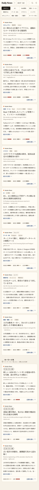 |
| ダーク | 通常と同じ並びを、暗い色で | 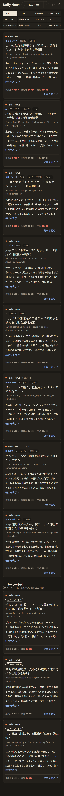 |
| PC | 中身の幅を広げ、マス目は6列×2段 | 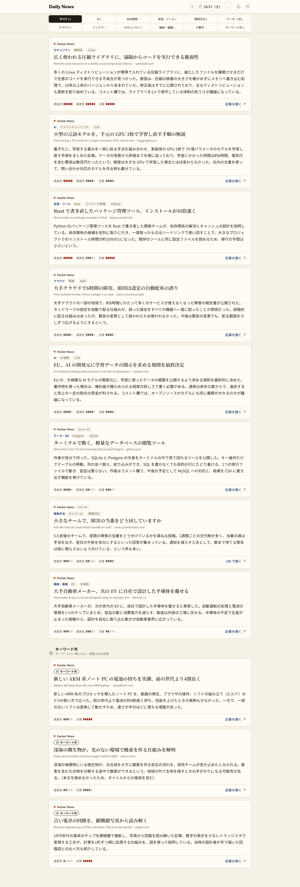 |
| 大量 | 記事が多くても、同じカードが縦に続く |  |
| 読み込み中 | カードの形の灰色の枠が4つ | 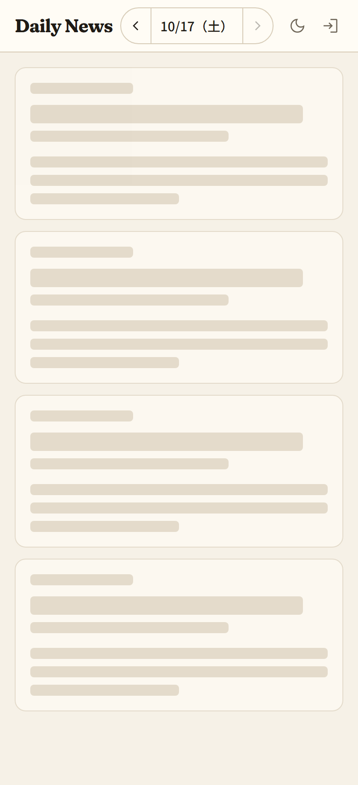 |
| エラー | エラーのアイコン、「読み込みに失敗しました」、補足、「再読み込み」 |  |
| その日が0件 | 「この日の記事はありません」、補足、「‹ 前日へ」。マス目は出さない | 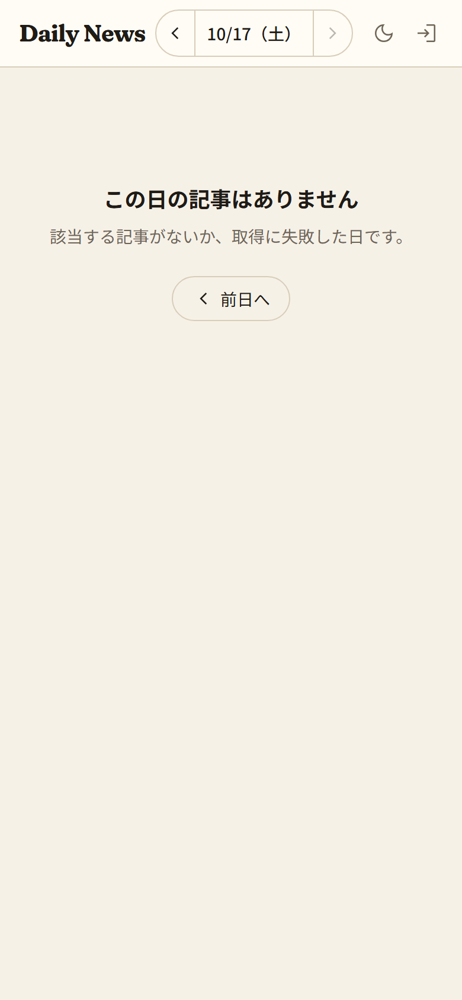 |
| カテゴリが0件 | マス目の下に「「IT業界」の記事はありません」、補足、「すべて表示」 | 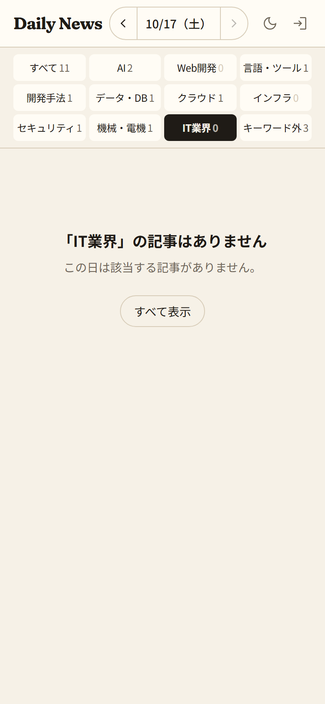 |
| AI を使えなかった日 | notice のお知らせ、英語タイトルのカード（反響だけ）。マス目は出さない | 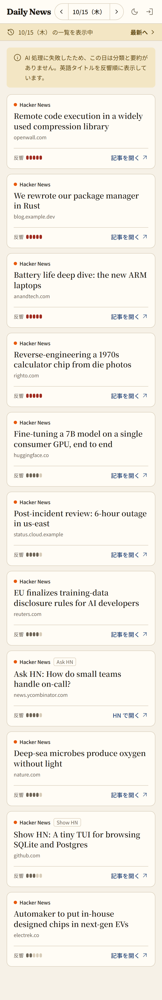 |
| 過去の日 | ヘッダーの下に「10/16（金）の一覧を表示中」「最新へ ›」の帯 | 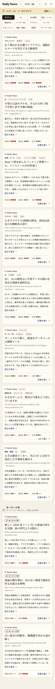 |
| いちばん古い日 | 「‹」が押せない |  |
| カレンダー | 日付の下に月のカレンダー。今日は link、選んでいる日は accent の丸。「直近90日まで」と「最新へ」 | 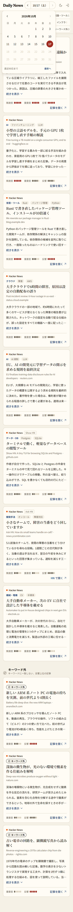 |
| 絞り込みの帯 | スクロールすると上に、選んでいるものの札・日付・「絞り込み」の帯 | 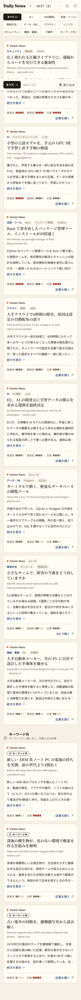 |
| 絞り込みを開いた | 帯の下にマス目、その下の記事を暗く。ボタンは「閉じる」 | 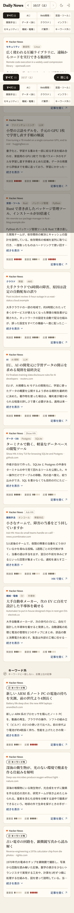 |
| 要約を開いた | 要約の全文と「折りたたむ」 | 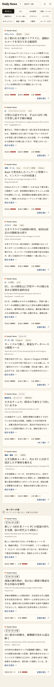 |

## やらないこと

- ログイン、印（保存・既読・興味なし）、保存済み、キーワードの設定の画面（#3〜#6）
- 記事本文の転載（要約と元記事へのリンクだけ）
- AI に記事を取得させること
- 1日に何回も更新すること。キーワードを変えたときに、その日の一覧を選び直すこと
- スコアやコメントの数、HN のコメントのページへのリンクを画面に出すこと
- Hacker News 以外のソース（取得処理を差し替えられる作りにはする）

## 決まっていないこと

- [ ] Q1 大きさ：取得・AI・反響・キーワードの DB・一覧の画面（カレンダー、絞り込み、明暗）を1つの機能にすると、タスクが10個を超える。Issue を「取得して JSON を作る」と「一覧の画面」に分ける？ 1つの仕様のままタスクで分ける？
- [ ] Q2 キーワードの置き場所：Issue では最初のキーワードを DB（Firestore）に入れる。そのためにこの Issue で Firebase の準備（プロジェクト、取得のスクリプトから読む鍵）まで要る。#4 まではリポジトリのファイルに置き、#4 で DB に移す？
- [x] Q3 最初のキーワード：カテゴリごとに何を入れる？ → 下のとおり。あとから変えられるので、ひとまずこれで始める。優先度は、AI の全部と AI駆動開発・テスト駆動開発・仕様駆動開発を高、ほかを中
  - AI：LLM、Claude、OpenAI、Gemini、GitHub Copilot、エージェント、RAG、ファインチューニング、バイブコーディング、ハーネスエンジニアリング、ループエンジニアリング
  - Web開発：React、TypeScript、Next.js、Vue、Angular、UI/UX
  - 言語・ツール：Rust、Go、Python、Java、Spring Boot、Git、エディタ
  - 開発手法：テスト、CI/CD、コードレビュー、ソフトウェア設計、AI駆動開発、テスト駆動開発、仕様駆動開発、DDD（ドメイン駆動設計）、クリーンアーキテクチャ
  - データ・DB：PostgreSQL、MySQL、SQLite、Oracle、データ基盤、Firebase、Supabase
  - クラウド：AWS、Google Cloud、Azure、Cloudflare、Vercel
  - インフラ：Kubernetes、Docker、Linux、ネットワーク
  - セキュリティ：脆弱性、認証、マルウェア、プライバシー
  - 機械・電機：半導体、ロボット、EV、電池、フィジカルAI
  - IT業界：買収、レイオフ、規制、オープンソース、SIer、SES、受託開発、自社開発
- [ ] Q4 ヘッダーのログインのボタン：合意した画面には写っているが、ログインは #3。この Issue では出さない？
- [ ] Q5 キーワード外の見出し：Issue は「キーワード外の話題」、合意した画面は「キーワード外」と補足「キーワードに一致しない、反響上位の記事」。どちらにする？
- [ ] Q6 「直近数日に載せた記事は除く」の日数は？
- [ ] Q7 反響の比べる相手：使い始めは直近30日の記録がない。30日たまるまでは、その日に取得した記事どうしで比べる？
- [ ] Q8 キーワードに関連する記事が8割（24件）に足りない日は、キーワード外で埋めて30件にする？ 少ないまま出す？
- [ ] Q9 同じ日に手動でもう一度動かしたら、その日の一覧を作り直して上書きする？
- [ ] Q10 一部の記事だけ AI の返事が読めなかったとき：その記事を一覧から外す？ 英語タイトルのまま載せる？
- [ ] Q11 90日より古い日のファイルは消す？ 残して一覧から見えないだけにする？
- [ ] Q12 「いちばん新しい日」：7:00 より前に開いたら前日の一覧が出る。カレンダーの「今日」の印は、その日（データのない今日）に付ける？ いちばん新しい一覧の日に付ける？
- [ ] Q13 いちばん古い日（90日前）が0件のとき、「‹ 前日へ」は出さない？
- [ ] Q14 同じ関連度の記事の並び：重要度、反響の順で並べる？
- [ ] Q15 キーワードに関連する記事が0件（キーワード外だけ）の日・キーワード外が0件の日は、見出し「キーワード外」を出す？

## 調べたこと

---

## 設計

## 確かめ方

-

## タスク

- [ ]
