<!--
変更の仕様のひな形。コピーして docs/changes/<年-月-日>-<何をするか>.md を作る（例：2026-09-17-add-due-date.md）。
「なぜ」〜「調べたこと」は、AIが下書きし、人間が答えて決める（/dev-spec）。「画面」のスクリーンショットは、プロトタイプで合意したときに足す（/dev-proto）。
「設計」以降はAIが下書きし、人間がレビューする（/dev-spec の続き）。
スクリーンショットは、このファイルと同じ名前のフォルダに置く（例：2026-09-17-add-due-date/list-empty.png）。
-->

# 毎朝、キーワードに関連する Hacker News の記事を日本語で読める（#2）

## なぜ

毎朝、自分が登録したキーワードに関連する Hacker News の記事を、日本語で手早く把握したい。キーワードだけだと視野が狭くなるので、キーワード外で反響の大きかった記事も2割混ぜる。今後ほかのソース（RSS など）も足していく。

## 影響する今の仕様

- 新規：`docs/specs/articles.md`（記事一覧の画面と、毎朝の取得・選び方）
- 今のページ（アプリ名だけの仮の画面 `docs/specs/screens/placeholder-default.png`）は、記事一覧に置き換わる

## 使う場面

1. 朝7時半、スマホで公開のページを開くと、今日（10/17）の一覧が出る。いちばん上に「セキュリティ」の、関連度5の記事「広く使われる圧縮ライブラリに、遠隔からコードを実行できる脆弱性」があり、日本語の要約を4行読んで、気になったので「記事を開く」で元記事を新しいタブで開く
2. 下までスクロールすると、見出し「キーワード外」のあとに、キーワードに一致しないが反響5の記事「新しい ARM 系ノート PC の電池の持ちを実測」が出る。上に出た帯の「絞り込み」から「AI」を選ぶと、AI の記事2件だけになる
3. 前の晩に Gemini の無料枠を使い切っていた日（10/15）をカレンダーで選ぶと、「AI 処理に失敗したため〜」のお知らせのあとに、英語タイトルの記事が反響の順に並ぶ

## 受け入れ条件

### 毎朝の取得と選び方

- 毎日 JST 7:00 に、自動で Hacker News の注目記事を取得し、その日の一覧を作って公開のページに出す。手動でも動かせる
- スコアが最低スコア（既定 50）未満の記事と、直近3日の一覧に載せた記事は、一覧に載せない
- 一覧はおよそ30件（件数は設定で変えられる）。8割がキーワードに関連する記事、2割がキーワード外の記事。キーワードに一致せず反響の小さい記事は載せない
- キーワードに関連する記事が8割に足りない日は、キーワード外の記事で埋める。反響の小さい記事では埋めないので、30件に届かない日もある
- AI の返事が読めなかった記事は、その日の一覧から外す（ほかの記事は載せる）
- 同じ日にもう一度動かしたら、その日の一覧を作り直して置き換える
- 各記事に、日本語のタイトル、要約（150〜300字、である調）、重要度（1〜5）を付ける。キーワードに関連する記事には、関連度（1〜5）、一致したキーワード、カテゴリも付ける。優先度が高いキーワードに関連するほど関連度を高くする
- 本文を読めなかった記事は、タイトルから要約し、要約の最後に「（本文を読めなかったため、タイトルからの推測を含む）」と付ける
- 記事が複数のカテゴリのキーワードに一致したら、優先度がいちばん高いキーワードのカテゴリに入れる。いちばん高い優先度のキーワードが複数のカテゴリにあれば、その中から AI が記事の内容にいちばん近いカテゴリを選ぶ
- 反響は、Hacker News の注目記事の直近30日の平均と比べて、スコアとコメント数がどれだけ多いかを5段階にしたもの。比べる相手は、毎朝取得した注目記事（一覧に載せなかったものも含む）。30日分たまるまでは、たまった分と比べる
- 投稿の種類（Show HN、Ask HN）は、タイトルの頭で判定する
- AI を使えなかった日（キーが設定されていない、AI が失敗した）は、英語タイトルだけで一覧を作り、キーワードでの仕分けはせず、反響の順に並べる
- 取得に失敗した日は、それまでの日の一覧を壊さない。その日は「記事がない日」になる
- 一覧は直近90日分を読める。90日より古い日の記事も消さずに残す（保存した記事を、#6 で90日より後も読めるように）
- キーワードを変えたら、次の朝の取得から使う。その日の一覧は選び直さない
- README に、手作業の設定の手順（AI のキーの登録、公開の設定、初回の手動実行）と、キーワードの直し方を書く

### 記事一覧の画面

- ページを開くと、いちばん新しい日の一覧が出る（7:00 より前に開くと前日の一覧）。ログインしていなくても誰でも読める
- ヘッダーには、アプリ名、日付の切り替え、明暗の切り替え、ログインのボタン（右端）を出す。ログインのボタンは、この機能では押しても何も起きない（Google のログインにつなぐのは #3）
- 並び順：キーワードに関連する記事を関連度の順（同じ関連度なら重要度、反響の順）、そのあとに見出し「キーワード外」と補足「キーワードに一致しない、反響上位の記事」を置いて、キーワード外の記事を反響の順。キーワード外の記事がない日は、見出しも出さない
- 記事ごとに、ソース（Hacker News）、投稿の種類（Show HN、Ask HN のときだけ）、カテゴリ（キーワード外の記事は「キーワード外」）、一致したキーワード、日本語の見出し、英語タイトルとドメイン、要約、関連度・重要度・反響、元記事へのリンクを出す。スコアとコメントの数は出さない
- 見出しと「記事を開く」で元記事を新しいタブで開く。Ask HN は「HN で開く」で Hacker News のページを開く
- 要約は4行で切り、収まらないときだけ「続きを表示」を出す。押すと全文になり、「折りたたむ」で戻る
- 指標の名前に指を乗せると説明が出る（関連度：「キーワードとの関連性（5段階・AI 判定）」、重要度：「ニュースとしての重要性（5段階・AI 判定）」、反響：「Hacker News の注目記事の直近30日と比べた反響（5段階・スコアとコメント数から算出）」）
- 絞り込み：「すべて」、カテゴリ、「キーワード外」のマス目に、それぞれの件数を出す。押すとその記事だけになる。スクロールしてマス目が見えなくなると上に帯が出て、「絞り込み」でマス目を開く。「閉じる」か暗い所を押すか、マスを選ぶと閉じる
- 選んだカテゴリが0件のとき：「「〇〇」の記事はありません」「この日は該当する記事がありません。」と「すべて表示」。押すと「すべて」に戻る
- 日付：ヘッダーの「‹」「›」で前後の日へ移る。真ん中の日付を押すとカレンダーが開き、直近90日の日だけを押せる。日を選ぶか外を押すと閉じる。それ以上進めない向きのボタンは押せない。カレンダーの「今日」の印は本当の今日に付き、その日の一覧がまだないうちは押せない
- 過去の日では、ヘッダーの下に「〇/〇（〇）の一覧を表示中」と「最新へ ›」の帯が出る。「最新へ」（カレンダーの「最新へ」も）で、いちばん新しい日の一覧に戻る
- その日の記事が0件（取得に失敗した日を含む）：「この日の記事はありません」「該当する記事がないか、取得に失敗した日です。」と「‹ 前日へ」。いちばん古い日（90日前）では「‹ 前日へ」を出さない
- AI を使えなかった日：一覧の上に「AI 処理に失敗したため、この日は分類と要約がありません。英語タイトルを反響順に表示しています。」と出し、記事にはソース・投稿の種類・英語タイトル・ドメイン・反響・リンクだけを出す
- 読み込み中：記事のカードの形の灰色の枠
- 読み込みに失敗した：「読み込みに失敗しました」「接続を確認して、再読み込みしてください。」と「再読み込み」。押すと読み直す
- 明暗の切り替え：最初は OS の設定に従い、ヘッダーのボタンで切り替えたら、その端末のブラウザに覚えておく
- スマホでも PC でも読める（PC は中身の幅を広げ、マス目を6列×2段にする）

## 画面

立ち上げで合意した画面（`docs/agreed-screens/`）を、この仕様に合わせて撮り直したもの。表示用の記事の並び（Q14）とキーワード（Q3）をこの仕様に合わせた。

### 記事一覧（articles）

| 状態 | 表示 | スクリーンショット |
| --- | --- | --- |
| 通常（スマホ） | 上に絞り込みのマス目（4列×3段）、記事のカード、見出し「キーワード外」、キーワード外の記事 | 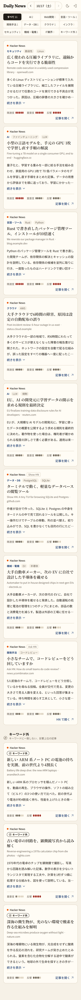 |
| ダーク | 通常と同じ並びを、暗い色で | 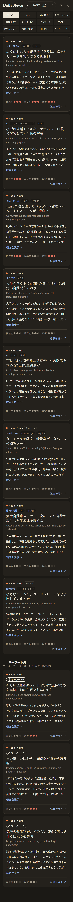 |
| PC | 中身の幅を広げ、マス目は6列×2段 | 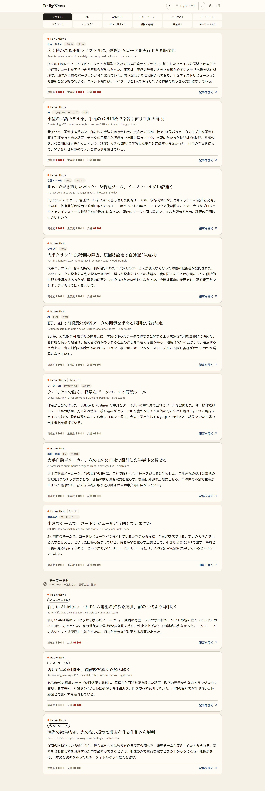 |
| 大量 | 記事が多くても、同じカードが縦に続く |  |
| 読み込み中 | カードの形の灰色の枠が4つ | 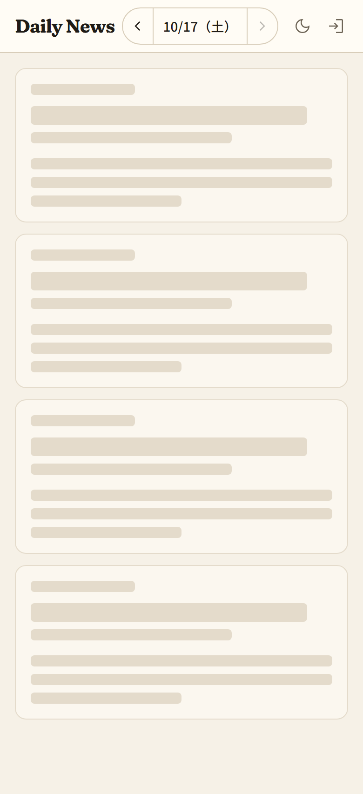 |
| エラー | エラーのアイコン、「読み込みに失敗しました」、補足、「再読み込み」 | 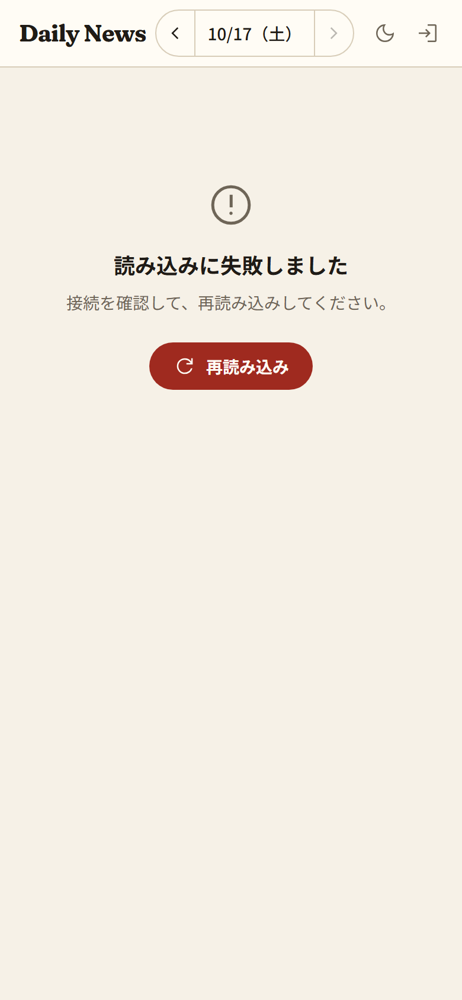 |
| その日が0件 | 「この日の記事はありません」、補足、「‹ 前日へ」。マス目は出さない |  |
| カテゴリが0件 | マス目の下に「「IT業界」の記事はありません」、補足、「すべて表示」 | 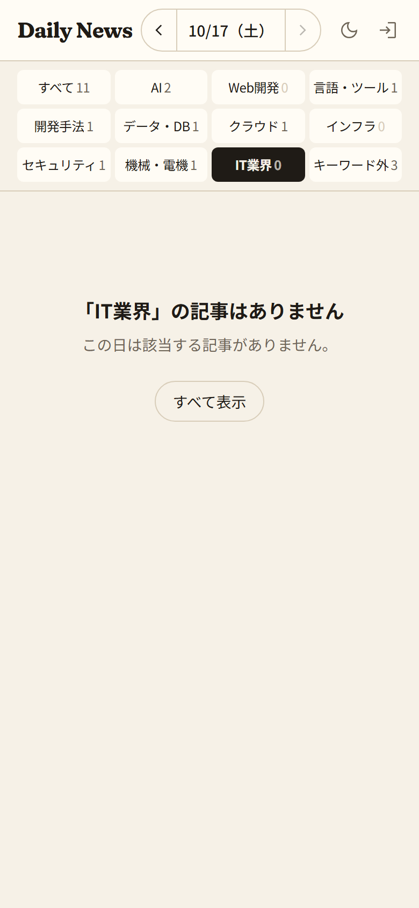 |
| AI を使えなかった日 | notice のお知らせ、英語タイトルのカード（ソース、投稿の種類、ドメイン、反響、リンク）。マス目は出さない | 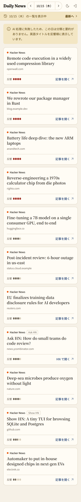 |
| 過去の日 | ヘッダーの下に「10/16（金）の一覧を表示中」「最新へ ›」の帯 | 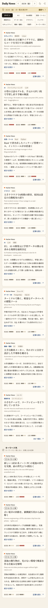 |
| いちばん古い日 | 「‹」が押せない |  |
| カレンダー | 日付の下に月のカレンダー。今日は link、選んでいる日は accent の丸。「直近90日まで」と「最新へ」 | 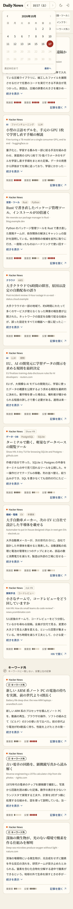 |
| 絞り込みの帯 | スクロールすると上に、選んでいるものの札・日付・「絞り込み」の帯 | 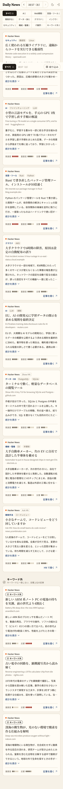 |
| 絞り込みを開いた | 帯の下にマス目、その下の記事を暗く。ボタンは「閉じる」 | 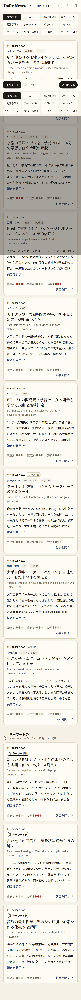 |
| 要約を開いた | 要約の全文と「折りたたむ」 | 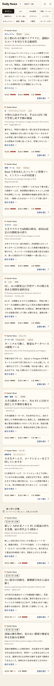 |

## やらないこと

- ログイン、印（保存・既読・興味なし）、保存済み、キーワードの設定の画面（#3〜#6）
- 記事本文の転載（要約と元記事へのリンクだけ）
- AI に記事を取得させること
- 1日に何回も更新すること。キーワードを変えたときに、その日の一覧を選び直すこと
- スコアやコメントの数、HN のコメントのページへのリンクを画面に出すこと
- Hacker News 以外のソース（取得処理を差し替えられる作りにはする）
- キーワードを DB に置くこと（#4 まではリポジトリのファイルに置き、#4 で DB に移す。Q2）

## 決まっていないこと

- [x] Q1 大きさ：取得・AI・反響・キーワードの DB・一覧の画面（カレンダー、絞り込み、明暗）を1つの機能にすると、タスクが10個を超える。Issue を「取得して JSON を作る」と「一覧の画面」に分ける？ 1つの仕様のままタスクで分ける？ → 1つの仕様のまま、タスクで分ける。取得とデータの形を先に、画面をあとに作る
- [x] Q2 キーワードの置き場所：Issue では最初のキーワードを DB（Firestore）に入れる。そのためにこの Issue で Firebase の準備（プロジェクト、取得のスクリプトから読む鍵）まで要る。#4 まではリポジトリのファイルに置き、#4 で DB に移す？ → #4 まではリポジトリのファイルに置く。Firebase は #3 で入れる
- [x] Q3 最初のキーワード：カテゴリごとに何を入れる？ → 下のとおり。あとから変えられるので、ひとまずこれで始める。優先度は、AI の全部と AI駆動開発・テスト駆動開発・仕様駆動開発を高、ほかを中
  - AI：LLM、Claude、OpenAI、Gemini、GitHub Copilot、エージェント、RAG、ファインチューニング、バイブコーディング、ハーネスエンジニアリング、ループエンジニアリング
  - Web開発：React、TypeScript、Next.js、Vue、Angular、UI/UX
  - 言語・ツール：Rust、Go、Python、Java、Spring Boot、Git、エディタ
  - 開発手法：テスト、CI/CD、コードレビュー、ソフトウェア設計、AI駆動開発、テスト駆動開発、仕様駆動開発、DDD（ドメイン駆動設計）、クリーンアーキテクチャ
  - データ・DB：PostgreSQL、MySQL、SQLite、Oracle、データ基盤、Firebase、Supabase
  - クラウド：AWS、Google Cloud、Azure、Cloudflare、Vercel
  - インフラ：Kubernetes、Docker、Linux、ネットワーク
  - セキュリティ：脆弱性、認証、マルウェア、プライバシー
  - 機械・電機：半導体、ロボット、EV、電池、フィジカルAI
  - IT業界：買収、レイオフ、規制、オープンソース、SIer、SES、受託開発、自社開発
- [x] Q4 ヘッダーのログインのボタン：合意した画面には写っているが、ログインは #3。この Issue では出さない？ → 出す（/dev-proto で見直した）。合意した画面のとおりヘッダーの右端に出し、押しても何も起きない。Google のログインにつなぐのは #3（Firebase は #3 で入れるため。Q2）
- [x] Q5 キーワード外の見出し：Issue は「キーワード外の話題」、合意した画面は「キーワード外」と補足「キーワードに一致しない、反響上位の記事」。どちらにする？ → 合意した画面のほう
- [x] Q6 「直近数日に載せた記事は除く」の日数は？ → 3日
- [x] Q7 反響の比べる相手は？ 使い始めは直近30日の記録がない → Hacker News という媒体の平均と比べる。毎朝取得する注目記事（約500件）のスコアとコメント数を記録し、直近30日分（たまるまでは、たまった分）と比べる。全投稿と比べると、一覧に載る記事がほぼ反響5になるため、注目記事どうしで比べる。検索 API（Algolia）で毎朝30日分を取る案は、取る量が多く、API が1つ増えるので選ばなかった
- [x] Q8 キーワードに関連する記事が8割（24件）に足りない日は、キーワード外で埋めて30件にする？ 少ないまま出す？ → キーワード外で埋める。反響の小さい記事では埋めない
- [x] Q9 同じ日に手動でもう一度動かしたら、その日の一覧を作り直して上書きする？ → 上書きする（失敗した日のやり直しに使える）
- [x] Q10 一部の記事だけ AI の返事が読めなかったとき：その記事を一覧から外す？ 英語タイトルのまま載せる？ → 外す（英語の記事が混ざると、並び順の決まりが崩れるため）
- [x] Q11 90日より古い日のファイルは消す？ 残して一覧から見えないだけにする？ → 消さずに残す。保存した記事は90日より後も読みたいため（記事は JSON にしかないので、消すと保存した記事も読めなくなる）。日付を選べるのは直近90日だけ
- [x] Q12 「いちばん新しい日」：7:00 より前に開いたら前日の一覧が出る。カレンダーの「今日」の印は、その日（データのない今日）に付ける？ いちばん新しい一覧の日に付ける？ → 本当の今日に付け、一覧がないうちは押せない
- [x] Q13 いちばん古い日（90日前）が0件のとき、「‹ 前日へ」は出さない？ → 出さない
- [x] Q14 同じ関連度の記事の並び：重要度、反響の順で並べる？ → そうする
- [x] Q15 キーワード外が0件の日は、見出し「キーワード外」を出す？ → 出さない
- [x] Q16 AI を使えなかった日のカードに、ソースと投稿の種類を出す？ → 出す（合意した画面のとおり。ふだんのカードと上の行がそろい、ソースを足したときにも見分けられる）
- [x] Q17 指標の説明の文言は？ → 5段階であることと、AI が付けたか計算したかが分かる文言にする（受け入れ条件のとおり）
- [x] Q18 記事が、同じ優先度の、別々のカテゴリのキーワードに一致したら？（例：「脆弱性」セキュリティ・中 と「Linux」インフラ・中） → AI が記事の内容にいちばん近いカテゴリを選ぶ
- [x] Q19 7:00 より前（Q12）の見た目を、状態として撮る？ → 撮らない。文章の決まりだけで作る
- [x] Q20 AI の呼び方は？ → 分類はまとめて送り、要約は1件ずつ送る。料金は回数でほとんど変わらず、時間がかかってもよいため（設計）
- [x] Q21 要約に使う本文は？ → 元記事の HTML から本文だけを取り出して送る
- [x] Q22 反響の5段階の区切りは？ → 偏差値で10ずつ区切る
- [x] Q23 取得に失敗した日は？ → その日の一覧がまだなければ、空の一覧を置く

## 調べたこと

- Gemini の Flash-Lite 系の安定版は `gemini-3.5-flash-lite` と `gemini-3.1-flash-lite`（https://ai.google.dev/gemini-api/docs/models 、2026-10-18 時点）。無料枠の回数の上限は公式のページに数字がなく、Google AI Studio で見る（https://ai.google.dev/gemini-api/docs/rate-limits ）
- 無料枠では、上限を超えた呼び出しは断られるだけで、料金はかからない。有料にしても料金は送った・返ってきた文字の量（トークン）で決まり、呼ぶ回数ではほとんど変わらない。回数で効くのは、無料枠の1分・1日の回数の上限だけ
- Hacker News の公式 API には、記事をまとめて取る方法がない（記事ごとに1回取る）

---

## 設計

### 全体の流れ（毎朝）

GitHub Actions の新しいワークフロー `daily.yml` が、毎日 JST 7:00（cron `0 22 * * *`）と手動で、`node src/batch/main.ts` を動かす。Node 24 は TypeScript をそのまま動かせるので（型を取り除くだけ。`tsconfig.node.json` の `erasableSyntaxOnly` がこれに合う）、tsx などは入れない。

1. キーワードのファイルを読み、形を確かめる（壊れていたら、`data/` に何も書かずに失敗で終わる）
2. ソース（Hacker News）から注目記事（topstories、最大500件）を取る。HN の API はまとめて取れないので、同時に10件ずつ並べて取る
3. 取った全件のスコアとコメント数を、その日の記録として残す（反響の比べる相手。Q7）
4. 最低スコア未満と、直近3日の一覧に載せた記事を外して、候補にする。候補の反響を計算する
5. AI で候補を分類する（関連度、一致したキーワード、カテゴリ）。候補を50件ずつまとめて送る
6. 分類と反響から、一覧に載せる記事を選び、並べる
7. 選んだ記事の本文を取り出し、1件ずつ AI に送って、日本語のタイトル・要約・重要度を付ける。無料枠の1分あたりの回数を超えないよう、間を空けて呼ぶ
8. その日の一覧と「いちばん新しい日」を書く
9. ワークフローが `data/` をコミットして main に push し、`deploy.yml` を呼んで出し直す（`docs/design.md` のとおり）

- AI の呼び方（Q20）：分類はまとめて送り（候補は100〜300件あり、1件ずつだと回数が多いため）、要約は1件ずつ送る
  - 比べた案：要約も10件ずつまとめる、全件を1回で送る。料金は回数でほとんど変わらず（調べたこと）、時間がかかってもよいので、1件の返事が壊れても失うのがその1件だけになる1件ずつにした。1日の呼び出しは、分類が数回と要約が30回ほどで、無料枠に収まる見込み
  - 前提（崩れたら見直す）：無料枠の1日の回数の上限に当たるようになったら、要約もまとめて送る。残す場所：`src/batch/main.ts` のコメント
- AI を使えなかった日：キーが設定されていない、または AI が回数の上限・認証・通信で失敗したら、その日は分類も要約もせず、候補を反響の順に30件選んで、英語タイトルだけの一覧にする。1件の返事が読めないだけなら、その記事だけを外す（Q10）
- 取得に失敗した日（Q23）：その日の一覧がまだなければ、「取得に失敗した」印の空の一覧を置いて、いちばん新しい日にする。すでに一覧がある日のやり直しで失敗したら、今ある一覧を残す
  - 比べた案：何も置かない。開くと前日の一覧が出て、失敗に気づきにくいので選ばなかった

### 取得のスクリプト（`src/batch/`）

| ファイル | すること |
| --- | --- |
| `main.ts` | 上の流れを順に動かす入口。今日の日付は JST で決める |
| `config.ts` | 変えられる値：一覧の件数（30）、最低スコア（50）、除外する日数（3）、反響の日数（30）、キーワード外に入れる反響（4以上）、関連する記事とみなす関連度（3以上）、本文の最大文字数（4000）、分類のまとめ件数（50）、要約の呼び出しの間隔、モデル名の既定値（`gemini-3.5-flash-lite`。環境変数 `GEMINI_MODEL` で変える） |
| `keywords.json` | キーワード（Q3）。`{ categories: [{ name, keywords: [{ word, priority: "high" \| "medium" \| "low" }] }] }`。README に直し方を書く |
| `keywords.ts` | キーワードのファイルを読み、形を確かめる（カテゴリ10個まで、名前6文字まで、優先度の値） |
| `source.ts` | ソースの型（`Source`：注目記事を取る）。ソースを足すときは、これを満たすものを足す |
| `hackernews.ts` | HN の API から取り、ソースの記事の形にする。投稿の種類はタイトルの頭（`Show HN:`、`Ask HN:`）で判定する。Ask HN は元記事がないので、リンクを HN のページにし、本文は投稿の文章を使う |
| `body.ts` | 元記事の HTML から本文の文字だけを取り出す（`@mozilla/readability` と、入っている `jsdom`。Q21）。取れなければ「本文なし」 |
| `summarizer.ts` | AI の型（`Summarizer`：分類する、要約する）。AI を変えるときは、これを満たすものを足す |
| `gemini.ts` | Gemini での `Summarizer`（`@google/genai`）。返事の形を JSON の型で指定し、受け取ったら形を確かめる |
| `reaction.ts` | 反響の計算 |
| `select.ts` | 一覧に載せる記事の選び方と並べ方 |
| `store.ts` | `data/` の読み書き（直近3日の記事、直近30日の記録、その日の一覧、いちばん新しい日） |

- 本文を読めなかった記事の要約の最後の一文「（本文を読めなかったため、タイトルからの推測を含む）」は、AI に頼まずコードで付ける（必ず同じ文言になるように）
- 選び方（`select.ts`）
  - 関連度が3以上で、キーワードが1つ以上一致した記事を「キーワードに関連する記事」、それ以外で反響が4以上の記事を「キーワード外の候補」にする。反響が3以下のキーワード外の記事は載せない
  - キーワードに関連する記事を、関連度・反響の順で24件（件数の8割）まで取り、残りをキーワード外の候補から反響の順で取る。関連する記事が24件に足りなければ、そのぶんキーワード外で埋める（Q8）
  - 一覧の並びは、要約で重要度が付いたあとに決める：キーワードに関連する記事を関連度・重要度・反響の順、そのあとキーワード外を反響の順（Q14）
- 反響（`reaction.ts`、Q22）：直近30日の記録（同じ記事は新しい日の値）から、スコアとコメント数をそれぞれ `log(1+値)` にして偏差値を出し、2つの平均で分ける。35未満=1、35〜45=2、45〜55=3、55〜65=4、65以上=5
  - 対数にする理由：スコアは一部の記事だけが桁違いに大きく、そのままだと平均が引っぱられて、ほとんどの記事が2〜3になるため
  - 記録が2件未満、またはばらつきが0なら3
  - 比べた案：直近30日の中での順位の割合で分ける（上位10%=5など）。「偏差値のように」から離れるので選ばなかった
  - 理由と前提は `src/batch/reaction.ts` のコメントに残す
- 1つのカテゴリに入れるときに、同じ優先度のキーワードが複数のカテゴリにあれば AI に選ばせる（Q18）。分類の返事のカテゴリが、一致したキーワードの中で優先度がいちばん高いもののカテゴリでなければ、コードでそちらに直す

### データ（`data/`）

型は `src/shared/articles.ts` に置き、スクリプトと表示ページの両方が使う。

| ファイル | 中身 |
| --- | --- |
| `data/articles/<YYYY-MM-DD>.json` | その日の一覧。`{ date, status: "ok" \| "no-ai" \| "failed", articles: Article[] }`。記事は表示する順に並べて置く |
| `data/latest.json` | いちばん新しい一覧の日。`{ date }` |
| `data/history/<YYYY-MM-DD>.json` | その日に取った注目記事の記録。`[{ id, score, comments }]`（反響の比べる相手） |

`Article`：`id`（`hn-<HN の id>`）、`source`（`"hackernews"`）、`postType`（`"show"` \| `"ask"` \| なし）、`titleEn`、`url`（元記事。Ask HN は HN のページ）、`domain`、`reaction`（1〜5）、`ai`（`no-ai` の日はなし）：`titleJa`、`summary`、`importance`、`keyword`（キーワード外はなし）：`relevance`、`keywords`、`category`

- 一覧を日ごとのファイルにする理由：表示ページは見る日のファイルだけを読めばよく、毎朝の更新もその日のファイルを足すだけで済むため。90日より古いファイルも消さない（Q11）
- `latest.json` を置く理由：表示ページが、どの日まで一覧があるかを、ファイルを探さずに知るため。7:00 より前に開くと前日の一覧が出るのも、これで決まる
- スコアとコメント数は、記録（`history/`）にだけ置き、一覧には置かない（画面に出さないため）
- 表示ページへの出し方：`vite.config.ts` の `publicDir` を `data` にし、build で `dist/` にそのまま入れる。開発のときも同じ URL（`/daily-news/articles/<日付>.json`）で読める
- 残す場所：データの持ち方と理由は `docs/design.md` の「データ」に書く（最後のタスク）

### 表示ページ（`src/web/`）

ライブラリは足さない（ルーター、データ取得、カレンダーなし）。日付はURLに入れず、画面の中の状態で持つ。

| ファイル | すること |
| --- | --- |
| `App.tsx` | 仮の画面を、記事一覧に置き換える |
| `articles/useDailyList.ts` | `latest.json` と、その日の一覧を読む。404 は「その日の記事がない」、ほかの失敗は「読み込みに失敗した」 |
| `articles/dates.ts` | 選べる日の範囲（いちばん新しい日から89日前まで）、前後へ進めるか、いちばん古い日か、JST の今日、「10/17（土）」の形 |
| `articles/filter.ts` | 絞り込みのマスごとの件数と、絞り込んだ記事 |
| `articles/` の部品 | ヘッダー（アプリ名、日付の切り替え、明暗、ログインのボタン）、カレンダー、過去の日の帯、絞り込みのマス目と帯、記事のカード、指標と説明、要約、お知らせ、読み込み中・0件・エラー |
| `theme.ts` | 明暗。選んだら `localStorage` に覚え、`<html>` の `color-scheme` を変える（トークンは `light-dark()` なので、色の値は変えない）。描く前に適用して、ちらつかせない |
| `icons.tsx` | 使う Material Symbols（Outlined、400）の SVG を写して置く。パッケージは入れない（使うのは10個ほどのため） |

- 要約の「続きを表示」は、4行で切った高さと全文の高さを比べ、はみ出るときだけ出す
- 絞り込みの帯は、マス目が画面から出たことを `IntersectionObserver` で知って出す
- 指標の説明は、指を乗せる（スマホでは押す）と出る小さな面にする
- ログインのボタンは、押しても何も起きないボタンとして置く（#3 でつなぐ）

### 画面の画像を撮る

- `e2e/screens/articles.spec.ts` で、`page.route` で `latest.json` と日ごとの一覧の返事を差し替えて、各状態を撮る（`docs/design.md` のとおり）。記事のデータは `e2e/fixtures/` に置く。日時は 2026-10-17 7:30（JST）に止める
- 仮の画面の `e2e/screens/placeholder.spec.ts` と `docs/specs/screens/placeholder-default.png` は消す

### 入れるパッケージ

- `@google/genai`（Gemini の公式の SDK。返事の形を指定する型がある）、`@mozilla/readability`。入れたタスクで `docs/libraries/` に下書きを書く
- `jsdom` は、取得のスクリプトでも使うので `dependencies` に移す。型の `@types/jsdom` は `devDependencies` に足す（jsdom に型がないため）

### 手作業の設定（README に書く）

- GitHub の Secrets に `GEMINI_API_KEY` を登録する（モデルを変えるときは、Variables に `GEMINI_MODEL`）
- GitHub Pages の公開元を GitHub Actions にする（#1 で済んでいれば確かめるだけ）
- Actions の画面から `daily` を手動で1回動かす

## 確かめ方

### 毎朝の取得と選び方

- 毎日 7:00 に自動・手動で動き、ページに出る：触って確かめる（手動で動かし、コミットと公開のページを見る）。7:00 の cron はコードを見て確かめる（`daily.yml`）
- 最低スコア未満と直近3日の記事を外す：テスト（`select.ts`。50 の境界の両側、3日前と4日前）
- 約30件、8割・2割、反響の小さいキーワード外を載せない：テスト（`select.ts`）
- 関連する記事が足りない日はキーワード外で埋め、30件に届かないこともある：テスト（`select.ts`）
- AI の返事が読めない記事を外す：テスト（`main.ts` の流れを、偽の `Summarizer` で）
- 同じ日の再実行で置き換える：テスト（`store.ts`）
- 各記事に日本語のタイトル・要約・重要度など、優先度が高いほど関連度を高く：返事の形はテスト（`gemini.ts` の形の確かめ）。要約の質と関連度の付き方は触って確かめる（手動で動かした一覧を読む）
- 本文を読めなかった記事の文言：テスト（`main.ts` の流れ）
- 複数カテゴリのときのカテゴリ：テスト（コードで直すところ）
- 反響の計算と、30日たまるまで：テスト（`reaction.ts`。区切りの境界、記録が少ないとき）
- 投稿の種類の判定：テスト（`hackernews.ts`）
- AI を使えなかった日：テスト（キーがないとき、AI が失敗したとき）
- 取得に失敗しても前の日を壊さない：テスト（`store.ts`、`main.ts` の流れ）
- 90日分を読める・古いファイルを残す：テスト（`dates.ts` の範囲）。消さないことはコードを見て確かめる（消す処理がない）
- キーワードの変更は次の朝から：コードを見て確かめる（毎朝ファイルを読むだけ）
- README の手順：触って確かめる（README のとおりに設定して動かす）

### 記事一覧の画面

- いちばん新しい日が出る（7:00 前は前日）・ログインなしで読める：テスト（`useDailyList`）
- ヘッダーの中身、ログインのボタンは何も起きない：触って確かめる（画面の画像）
- 並び順と、キーワード外の見出し（0件なら出さない）：並び順はテスト（`select.ts`）。見出しを出す・出さないはテスト（画面）
- カードの中身、スコアを出さない：触って確かめる（画面の画像）
- リンクの文言（Ask HN は「HN で開く」）と新しいタブ：テスト（画面）
- 要約の4行と「続きを表示」「折りたたむ」：触って確かめる（jsdom では高さを測れないため、画面の画像と、ブラウザで押す）
- 指標の説明：触って確かめる
- 絞り込みのマス目・件数・帯・開閉：件数と絞り込みはテスト（`filter.ts`）。帯と開閉は触って確かめる（画面の画像）
- カテゴリが0件のとき：テスト（画面。「すべて表示」で戻る）
- 日付の移動、カレンダーで押せる日、進めない向き、今日の印：テスト（`dates.ts`。範囲の両端、今日に一覧がないとき）
- 過去の日の帯と「最新へ」：テスト（画面）
- その日が0件、いちばん古い日に「前日へ」を出さない：テスト（画面）
- AI を使えなかった日のお知らせとカード：テスト（画面。お知らせを出し分ける）
- 読み込み中：触って確かめる（画面の画像）
- 読み込みに失敗した・「再読み込み」：テスト（画面）
- 明暗の切り替えと覚えること：テスト（`theme.ts`）
- スマホと PC：触って確かめる（画面の画像）

## タスク

- [x] 1. 記事の型と、反響・選び方の計算：`src/shared/articles.ts`、`config.ts`、`keywords.json`・`keywords.ts`、`reaction.ts`、`select.ts` とそのテストができたら完了
- [x] 2. HN から取って英語の一覧を作る：`source.ts`、`hackernews.ts`、`body.ts`、`store.ts`、`main.ts` ができ、AI のキーがなくても `node src/batch/main.ts` で `data/` に英語タイトルの一覧（`no-ai`）・記録・いちばん新しい日が書かれたら完了
- [x] 3. Gemini で分類・要約する：`summarizer.ts`、`gemini.ts` ができ、キーがあれば日本語の一覧（`ok`）が、AI が失敗したら英語の一覧が書かれたら完了
- [ ] 4. 毎朝のワークフローと README：`daily.yml` が 7:00 と手動で動いて `data/` をコミットし、出し直し、README に設定の手順とキーワードの直し方が書かれたら完了（取り込んだあと、人間が手動で1回動かして、`data/` に一覧を作る）
- [ ] 5. 記事一覧の画面：いちばん新しい日の一覧を、ヘッダー（‹ › での日付の移動、明暗、ログインのボタン）、絞り込みのマス目、カード、要約の開閉、指標の説明、読み込み中・エラー・その日が0件・カテゴリが0件の表示つきで出せたら完了。仮の画面は消す。合わせる画像：`articles-default.png`、`articles-default-dark.png`、`articles-default-pc.png`、`articles-many.png`、`articles-summary-open.png`、`articles-loading.png`、`articles-error.png`、`articles-empty-day.png`、`articles-empty-category.png`、`articles-oldest.png`
- [ ] 6. 過去の日とカレンダー、AI を使えなかった日：過去の日の帯と「最新へ」、カレンダー、AI を使えなかった日のお知らせとカードが出せたら完了。合わせる画像：`articles-past.png`、`articles-calendar.png`、`articles-no-summary.png`
- [ ] 7. 絞り込みの帯：スクロールで帯が出て、「絞り込み」でマス目を開閉できたら完了。合わせる画像：`articles-category-bar.png`、`articles-category-panel.png`
