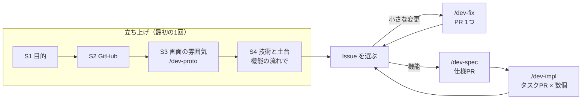
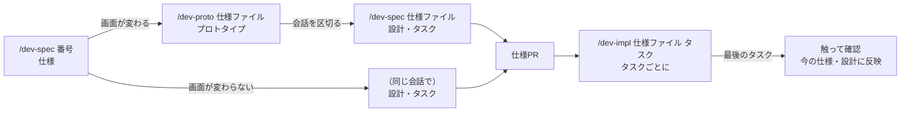

# 開発の進め方

人間向けの説明。AIが守る決まりは `AGENTS.md` とスキル（`.claude/skills/`）にあり、ここからはリンクするだけにしている。

## 考え方

1. **仕様が先、コードは後**：作る前に何を作るかを書き、決まっていないことを残さない。途中でずれたら、コードより先に仕様を直す
2. **人間は判断、AIは下書きと実装**：何を作るかを決める、決まっていないことに答える、レビューしてマージする、実際に触って確かめる。この4つは人間がやる
3. **流れは、うまくいかなかったときの影響で選ぶ**：小さな変更はすぐ直し、データや権限に触るものは仕様から始める
4. **AIに見せるものを絞る**：AIが毎回読むのは大枠（`AGENTS.md`）だけ。細かい決まりは、作業に合わせてスキルで読み込ませる。過去の変更の記録とプロトタイプは見せず、作業の区切りで会話も区切る
5. **守りたいことは仕組みで止める。ただし確実に止められるものだけ**：マージ、main への push、force push、秘密情報は、設定とフックで止める。それ以外は、決まりとレビューで守る
6. **うまくいかなかったら、決まりを直す**：同じ注意を2回しない。ただし足すだけでなく、まとめる・消すことも考える（決まりが増えすぎると、大事なものが埋もれる）

決まった時間割（スプリントなど）は使わない。**1つの機能ができたら、次の機能へ進む。**

## 全体の流れ

文書は、**今の状態** と **変更の記録** に分けてある。変更の記録に書いたことは、機能の最後のタスクで今の状態に移す。AIは今の状態だけを読む。

| 種類 | 場所 | 書くこと |
| --- | --- | --- |
| 今の仕様 | `docs/specs/`、`docs/specs/screens/` | アプリが今どう動くか。今の画面の画像（AIが本番から撮る） |
| 今の設計 | `docs/design.md` | アプリが今どう作られているか。複数の場所に関わる決まりと、その理由・前提 |
| 今の見た目の決まり | `docs/ui.md` | 色・余白・文字・部品の使い分け。値はトークンファイルに書く |
| 目的・用語・技術 | `docs/overview.md` | 何のためのアプリか、やらないこと、用語、使う技術 |
| 変更の記録 | `docs/changes/<日付>-<何をするか>.md` と同じ名前のフォルダ | 機能ごとの仕様・設計・タスクと、合意した画面。終わったら書き換えず、経緯として残す（AIは読まない） |

## 立ち上げ（最初の1回だけ）

Node.js を入れておく（Claude Code のフックが使う）。

**S1. 目的とやらないことを書く**

- [ ] `docs/overview.md` の「目的」「使う人」「主な機能」「やらないこと」を書く。AIに「あいまいな点を質問して。技術の話はまだしないで」と頼んでもよい

**S2. GitHub の設定**

- [ ] テンプレートの「Use this template」でリポジトリを作って clone し、gh CLI でログインして `bash scripts/setup-github.sh` を実行する
  - Squash merge だけにする、main への push、force push、秘密情報を含む push を手元の Git のフックで止める、テンプレートとつなぐ（`.template-version` を書き、テンプレートのリポジトリだけで使うファイルを消す。どちらも S3 の PR に入る）。使えるプランなら、GitHub のブランチ保護と push protection も設定する
  - clone し直したら、`bash scripts/link-template.sh` で remote `template` を足し直し、Git のフックを有効にし直す

**S3. 画面の雰囲気と主な画面を決める（`/dev-proto`）**

- [ ] プロトタイプのフォルダを、このリポジトリの外に作る。`~/.claude/settings.json` の `additionalDirectories` には入れない（本番の作業でプロトタイプを読ませない守りは、読むときに出る確認だけのため）
- [ ] AIが出す雰囲気の2〜3案から **1つ選ぶ**。主な画面を触って直しを伝え、合意するまで繰り返す
- [ ] AIが出す機能の分け方の案から、Issue にするものを **決める**
- [ ] AIが出す PR（`docs/ui.md`・`docs/overview.md`・合意した画面の画像・仮のトークン）をレビューして **マージしてから**、会話を区切って S4 へ
- [ ] プロトタイプのフォルダは消さずに残す（機能ごとの `/dev-proto` で使う）

**S4. 技術を決め、開発の土台を作る**

- [ ] S3 でAIが作った Issue「開発を始められる」を、機能の流れ（`/dev-spec` → `/dev-impl`）で進める。技術の候補をAIが比べるので、**自分で決める**。作るものと順番は [foundation スキル](../.claude/skills/foundation/SKILL.md)
- [ ] CI ができたら、これ以降はマージの前に CI が通っていることを確かめる（非公開のリポジトリで GitHub Free だと、CI が失敗していてもマージできてしまう）

## 毎回の流れ

Issue に取りかかるとき、打つコマンドで流れを選ぶ。迷ったら `/dev-fix` を打ってよい。機能の流れに当たれば、AIが止まって伝える。

| 流れ | 当てはまるもの | コマンド |
| --- | --- | --- |
| 小さな変更 | 1か所の動き・文言・バグ修正・整理 | `/dev-fix <番号>` |
| 機能 | 新しい画面や機能。小さくても、うまくいかなかったときの影響が大きいもの（基準は [dev-fix の「機能の流れにするもの」](../.claude/skills/dev-fix/SKILL.md#機能の流れにするもの)） | `/dev-spec <番号>` から |

### 機能

人間がやること：

| いつ | やること |
| --- | --- |
| `/dev-spec`（仕様） | AIが「使う場面」を具体例で言い換えてくるので、**違っていたらここで直す**。質問に答える |
| `/dev-proto` | 触って直しを伝える。立ち上げで合意した画面と仕様が食い違えば、**どちらに合わせるかを選ぶ** |
| `/dev-spec`（設計） | やり方の選択肢から **選ぶ**。仕様PRで、すべての受け入れ条件に確かめ方があるか、タスクが「〜ができたら完了」と1文で言えるかを見て、マージする |
| `/dev-impl` | AIが止まって質問してきたら決める（仕様ファイルを先に直させる）。タスクPRの差分と、撮り直した画面の画像を見て、CI が通っていればマージする |
| 最後のタスク | AIが出す表に沿って、**実際にアプリを触って** 確かめる。出てきた新しい要望は、作らずに新しい Issue にする |

### 小さな変更（`/dev-fix`）

- Issue に「どうなるべきか」を書く。バグなら「今どうなっているか」「再現手順」も書く
- AIが、動きが変わるならテストを先に書いて直し、1つの PR（`Closes`）を出す。差分を見てマージする

### 大きさの決め方

「AIが書ける量」ではなく **「自分がレビューできる量」** で決める。仕様が固まらなければ Issue を分ける。タスクの完了条件を1文で言えなければ、タスクを分ける。PR が大きすぎたら、マージせずにタスクを分け直す。

## 決まりの置き場所

AIが一度に読む量が多いと、決まりが守られにくくなる。決まりは、要るときにだけ読まれる場所に置く。**1つの決まりは1か所にだけ書き、ほかからはスキル名で指す。**

| いつ要るか | 置き場所 | 読まれるとき |
| --- | --- | --- |
| 毎回 | `AGENTS.md`（テンプレートの決まり）、`CLAUDE.project.md`（このプロジェクトで足した決まり） | 会話の始め |
| 1つのコマンドの中だけ | 手順スキル（`/dev-spec` など）と、そのフォルダの補助ファイル | 人間がコマンドを打ったとき |
| いくつかの作業で | 知識スキル（[testing](../.claude/skills/testing/SKILL.md)、[screenshots](../.claude/skills/screenshots/SKILL.md)、[code-notes](../.claude/skills/code-notes/SKILL.md)、[permissions](../.claude/skills/permissions/SKILL.md)、[foundation](../.claude/skills/foundation/SKILL.md)） | AIが作業に合わせて自分で読む |
| 決まったファイルを触るときだけ | `.claude/rules/`（`paths:` で指定） | そのファイルを読んだとき |

- うまくいかなかったことは、`CLAUDE.project.md` の「うまくいかなかったことから追加したルール」に足す。原因がテンプレートにあるなら、そのファイルを直す（下の「テンプレートとのつながり」）
- 足すときに、似た決まりがないかを見て、まとめる。使わなくなった決まりは消す

AIが実行してよいコマンド（`.claude/settings.json`）とフックの中身は、[permissions スキル](../.claude/skills/permissions/SKILL.md) にある。

## GitHub Copilot で使うとき

ルール（`AGENTS.md`）とスキル（`.claude/skills/`）は、Claude Code と同じものを使う。分けて書かない。

- **VS Code のエージェント**：設定で `chat.useAgentsMdFile` を有効にする。コマンドは同じく `/dev-fix 15` のように打てる
- **GitHub 上のエージェント**：Issue を割り当て、コメントで「dev-fix の手順で」「dev-spec の手順で」と流れを伝える。AIは `.claude/skills/<名前>/SKILL.md` を読んで進める。ブランチ名は `copilot/...` になる
- **守りの差**：Copilot では、`.claude/settings.json` の deny とフック（マージ禁止、`.env` を読ませない）が効かず、ルールで頼むだけになる。VS Code では、main への push、force push（リモートのブランチを書き換える push）、秘密情報を含む push は、Claude Code と同じく `.githooks/pre-push` で止まる（clone したあと、`scripts/link-template.sh` を実行するか Claude Code の会話を始めると有効になる）。GitHub 上のエージェントは GitHub の環境で動くので `.githooks/` は動かないが、自分のブランチ（`copilot/...`）にしか push できない。使えるプランなら、main のブランチ保護と push protection を設定しておく
- サブエージェント（`test-runner`、`pr-check`）が使えないときは、AIが同じことを自分で行う（`AGENTS.md` に書いてある）

## テンプレートとのつながり

ファイルは、テンプレートのもの・両方が書くもの・プロジェクトのものに分けてある（[docs/template-files.md](template-files.md)）。

- 使う側でテンプレートの不備に当たったら、その場で直し、PR の本文に何が起きたかを書く。テンプレートのリポジトリで `/template-harvest <owner/repo>` を使うと、直したものが集まる
- テンプレートで直したものは、使う側で `/template-sync` を使って取り込む。取り込めるものがあれば、機能の最後のタスクでAIが教えてくれる

## 困ったとき

| 困ったこと | 最初にやること |
| --- | --- |
| 実装中に、仕様にない場合が出てきた | AIを止めて自分で決め、仕様に書き足してから再開する |
| AIが頼んでいない所まで変えた、仕様にない要素を画面に足した | 取り除かせる。繰り返すなら `CLAUDE.project.md` に書く |
| テストは通るのに、触ると動かない | 受け入れ条件に対応するテストが足りない。テストを足す |
| 画面を変えていないのに、画像を比べるテストが失敗した | AIに、どの画面がどう変わったかを見せてもらう。意図した変化なら撮り直させ、意図しない変化なら原因を直させる |
| 画像を比べるテストが、何もしていなくても失敗する | 撮るたびに変わるもの（日時、アニメーション）か、Docker イメージの外で撮った画像が混ざった。AIに原因を探させる |
| 本番の作業中に、プロトタイプのフォルダを読む確認が出た | 断る。繰り返すなら、会話を区切ってやり直す |
| フックが、ふつうの作業を止めた | 止まったコマンドと理由を Issue にする。急ぐなら、AIに別の書き方を頼む |
| push が「秘密情報らしいもの」で止まった | 出たファイルを自分で確かめる。本物なら、コミットの履歴から取り除かせる（外には出ていない）。誤検知なら、自分で `git push --no-verify` する |
| フックのエラーが毎回出る | Node.js が入っているか確かめる |
| AIが毎回同じことを聞いてくる | 答えを `docs/overview.md`（用語・技術）、`docs/design.md`（作り方）、`docs/ui.md`（見た目）、`CLAUDE.project.md`（進め方）のどれかに書く |
| 会話が長くなって、AIが前提を忘れる | 会話を区切り、コマンドからやり直す（前提はファイルにある） |
| 仕様どおりなのに使いにくい | 今の機能は完成にする。直したい点は新しい Issue にする |
